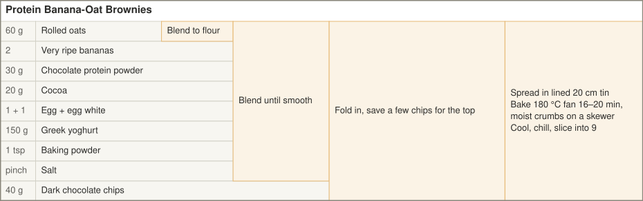

<!-- Generated from protein-banana-oat-brownies.yaml by tools/render.py. Edit the YAML, not this file. -->

# Protein Banana-Oat Brownies

Fudgy banana-oat brownies, blender only.

- **Makes:** 9 squares
- **Per square:** ~110 cal / 7–8 g protein (~65 g protein per tray)
- **Tin:** 20 cm square, lined
- **Bake:** 180 °C fan, 16–20 min

## At a glance

Read left to right. Each shaded box is a step that combines everything to its left.

## Ingredients

### Oat flour

| Ingredient | Amount |
| --- | --- |
| Rolled oats | 60 g |

### Wet mix

| Ingredient | Amount |
| --- | --- |
| Very ripe bananas | 2 |
| Chocolate protein powder | 30 g — 1 scoop |
| Cocoa | 20 g |
| Egg + egg white | 1 + 1 |
| Greek yoghurt | 150 g |
| Baking powder | 1 tsp |
| Salt | pinch |

### Folded in

| Ingredient | Amount |
| --- | --- |
| Dark chocolate chips | 40 g |

### Optional

| Ingredient | Amount |
| --- | --- |
| Milk | 2–3 tbsp — only if the batter is stiff |

## Method

1. **Make the oat flour.** Blend the oats to a fine flour.
2. **Blend the batter.** Add the bananas, protein powder, cocoa, egg and egg white, Greek yoghurt, baking powder and salt. Blend until smooth.
3. **Fold in the chocolate.** Fold in the chocolate chips, saving a few to scatter on top.
4. **Bake.** Spread into the lined 20 cm tin and bake at 180 °C fan for 16–20 minutes. Pull them when a skewer comes out with moist crumbs.
5. **Cool and chill.** Cool in the tin, then chill before slicing into 9 squares.

## Notes

- Underbake. Whey dries out fast, so pull them when a skewer comes out with moist crumbs.
- Plant protein soaks up more liquid. Add 2–3 tbsp milk if the batter is stiff.
- Unflavoured powder works too. Add 1–2 tbsp honey or sweetener.
- Chill overnight. They get denser and more brownie-like. Keeps about 4 days in the fridge, or freeze them individually.
- Higher-protein variant: double the powder to 2 scoops (60 g), drop the oats to 40 g and add a splash of milk. That gets you ~10 g protein per square, but the texture goes more cakey.
