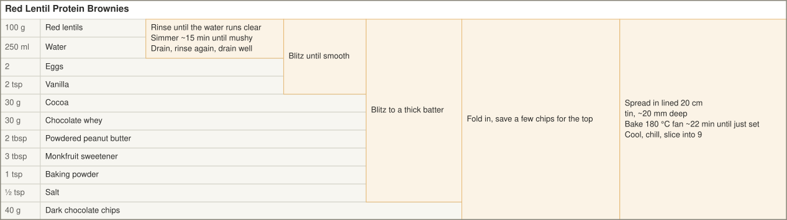
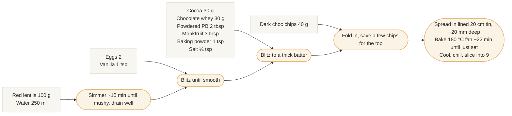

<!-- Generated from red-lentil-protein-brownies.yaml by tools/render.py. Edit the YAML, not this file. -->

# Red Lentil Protein Brownies

Fudgy, flourless, high-protein.

- **Makes:** 9 squares
- **Per square:** ~110 cal / 8 g protein
- **Tin:** 20 cm square, lined
- **Bake:** 180 °C fan, ~22 min

## At a glance

Read left to right. Each shaded box is a step that combines everything to its left.

Mermaid version (being replaced by the chart above)

## Ingredients

### Lentils (cooked first)

| Ingredient | Amount |
| --- | --- |
| Red lentils | 100 g |
| Water | 250 ml |

### Blitzed with the lentils

| Ingredient | Amount |
| --- | --- |
| Eggs | 2 |
| Vanilla | 1 tsp |

### Dry mix

| Ingredient | Amount |
| --- | --- |
| Cocoa | 30 g |
| Chocolate whey | 30 g |
| Powdered peanut butter | 2 tbsp |
| Monkfruit sweetener | 3 tbsp |
| Baking powder | 1 tsp |
| Salt | ¼ tsp |

### Folded in

| Ingredient | Amount |
| --- | --- |
| Dark chocolate chips | 40 g |

### Optional

| Ingredient | Amount |
| --- | --- |
| Protein yoghurt | 50 g — only if the batter is too stiff to spread |

## Method

1. **Cook the lentils.** Simmer the red lentils in the water for ~15 minutes, until mushy. Drain well.
2. **Blitz smooth.** Add the eggs and vanilla to the drained lentils and blitz until completely smooth.
3. **Add the dry mix.** Add the cocoa, whey, powdered peanut butter, monkfruit, baking powder and salt. Blitz to a thick batter.
4. **Fold in the chocolate.** Fold in the chocolate chips, saving a few to scatter on top.
5. **Bake.** Spread into the lined 20 cm tin, about 20 mm deep. Bake at 180 °C fan for ~22 minutes, until just set.
6. **Cool and chill.** Cool in the tin, then chill before slicing into 9 squares.

## Notes

- Drain the lentils well — leftover water makes the brownies gummy. Only add the 50 g protein yoghurt if the batter is too stiff to spread.
- Blitz completely smooth so there's no lentil texture. Taste the raw batter and add more monkfruit if you want it sweeter.
- Pull it slightly underbaked; it firms up as it cools and gets fudgier cold.
- Keeps ~4–5 days in the fridge and freezes well.
